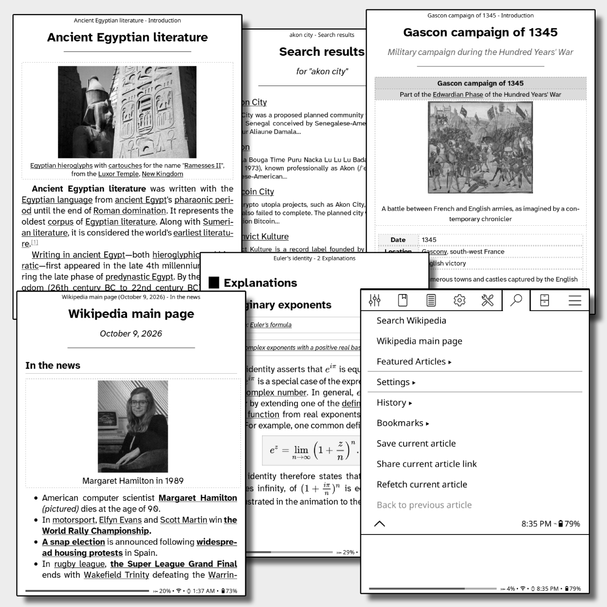

# WikiReader
A KOReader plugin for reading Wikipedia articles as formatted books, with a cleaner reading experience than the built-in Wikipedia lookup.

  

## Features:
- Articles are opened as EPUBs directly without explicitly saving them
- Cleaner formatting than the built-in Wikipedia lookup
- Search Wikipedia articles
- Access featured articles
- Bookmark articles
- Save current article as book in your library
- Gesture support for quick access
- and more...

> [!NOTE]
> When an article is opened, it is saved as a temporary EPUB file in the koreader cache folder. The cache holds at most 10 EPUBs, with newer articles automatically replacing older ones. The cache can grow anywhere from 20 MB to 200 MB, depending on how image-heavy the articles you've read are. You can clear this cache from WikiReader Settings, if needed.

## Usage
- Download the plugin from the [releases page](https://github.com/chandujr/wikireader.koplugin/releases)
- Copy the folder `wikireader.koplugin` to `koreader/plugins` folder on your device
- Restart the device
- Access `WikiReader` menu from the `Search` button in the top menu

## Support Me

If you find this plugin helpful, please consider supporting me:

<table style="border:none;text-align: center">
  <tr>
    <td></td>
  </tr>
  <tr>
    <td></td>
  </tr>
</table>

## License
AGPL-3.0